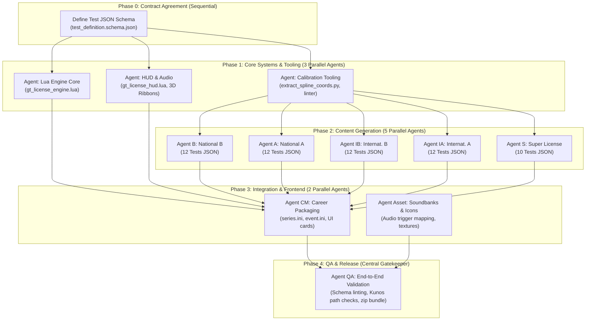

# Multi-Agent Parallelization Strategy & Execution Architecture

## 1. Executive Summary

Because the project is designed with a **decoupled, schema-first architecture** (separating the Lua simulation engine, declarative test data, tooling, and Content Manager packaging), it is **exceptionally well-suited for parallelized multi-agent execution**.

Instead of a single AI working sequentially through 58 tests and engine modules over many hours, work can be decomposed into independent streams executed concurrently by specialized AI subagents.

### Key Benefits of Multi-Agent Parallelization:
* **70%+ Reduction in Development Time**: Up to 5 license tiers can be calibrated, authored, and validated in parallel.
* **Separation of Concerns**: Graphics/HUD specialists work independently of physics/engine specialists without code conflicts.
* **Zero Merge Collisions**: A strict directory and file topology ensures that agents write to non-overlapping paths.
* **Continuous Machine-Verifiable Gates**: Tooling agents construct validators before content agents generate data, enforcing quality at every step.

---

## 2. Dependency Graph & Concurrency Model

The project follows a **Phase-Gated Concurrency Model**. Phases with strict dependencies are executed sequentially, while work within each phase runs in full parallel.



---

## 3. Multi-Agent Roster & Role Definitions

When deploying an agent swarm in Antigravity (using `invoke_subagent`), each subagent is assigned a distinct role, prompt scope, and isolated file domain:

| Agent Role | Responsibility | Input Dependencies | Output Artifacts | Isolation Boundary |
| :--- | :--- | :--- | :--- | :--- |
| **Lead Orchestrator**<br>*(Parent Agent)* | Coordinates lifecycle, dispatches subagents, reviews PRs/commits, manages Git history. | User specifications | Project milestones, status reports | Root repository |
| **Tooling & Calibration Specialist** | Builds the Python spline coordinate extractor and automated schema validator. | `test_definition.schema.json` | `tools/extract_spline_coords.py`<br>`tools/validate_curriculum.py` | `tools/` |
| **Lua Simulation Engine Specialist** | Develops session lifecycle, physics hooks, rolling launch vector math, collision & off-track failure tripwires. | CSP Lua SDK documentation | `lua/gt_license_engine.lua`<br>`lua/gt_physics_hooks.lua` | `lua/engine/` |
| **HUD & Presentation Specialist** | Develops the vector GT-style HUD, timer display, target deltas, 3D timing ribbons, and audio trigger handlers. | GT HUD visual references | `lua/gt_license_hud.lua`<br>`lua/render_gates.lua` | `lua/ui/` |
| **License Tier Author: B** | Generates 12 National B test JSON definitions and extracts track coordinates via calibration tools. | Calibration script + Schema | `content/tests/national_b/*.json` | `content/tests/national_b/` |
| **License Tier Author: A** | Generates 12 National A test JSON definitions and extracts track coordinates. | Calibration script + Schema | `content/tests/national_a/*.json` | `content/tests/national_a/` |
| **License Tier Author: IB** | Generates 12 International B test JSON definitions and extracts track coordinates. | Calibration script + Schema | `content/tests/international_b/*.json` | `content/tests/international_b/` |
| **License Tier Author: IA** | Generates 12 International A test JSON definitions and extracts track coordinates. | Calibration script + Schema | `content/tests/international_a/*.json` | `content/tests/international_a/` |
| **License Tier Author: S** | Generates 10 Super License test JSON definitions for full-lap hot laps. | Calibration script + Schema | `content/tests/super_license/*.json` | `content/tests/super_license/` |
| **Content Manager Packaging Specialist** | Builds the custom career series folders, prerequisite unlock chains (`REQUIRES=`), and UI briefings. | Test JSONs | `content/career/series_gt_*/` | `content/career/` |
| **QA & Conformance Specialist** | Executes full validation suites, lints all JSONs, verifies content IDs against AC installation. | Completed mod files | Validation report & final distribution zip | Repository-wide Read-only |

---

## 4. Conflict Prevention & Synchronization Strategy

To ensure multiple agents can work simultaneously without stepping on each other's code, the strategy employs four safeguards:

### 4.1 Strict Directory Topology
Each agent is assigned exclusive write access to a non-overlapping directory:
```
d:\Repositories\AssettoCorsa-GTLikeLicenses\
├── schema/                 <-- (Phase 0: Orchestrator only)
├── tools/                  <-- (Phase 1: Tooling Agent only)
├── lua/
│   ├── engine/             <-- (Phase 1: Engine Agent only)
│   └── ui/                 <-- (Phase 1: HUD/Render Agent only)
├── content/
│   ├── tests/
│   │   ├── national_b/     <-- (Phase 2: Author Agent B only)
│   │   ├── national_a/     <-- (Phase 2: Author Agent A only)
│   │   ├── international_b/<-- (Phase 2: Author Agent IB only)
│   │   ├── international_a/<-- (Phase 2: Author Agent IA only)
│   │   └── super_license/  <-- (Phase 2: Author Agent S only)
│   └── career/             <-- (Phase 3: Packaging Agent only)
└── release/                <-- (Phase 4: QA Agent only)
```

### 4.2 The "Schema as Law" (Contract-First Architecture)
Before any code or content is written, the schema contract is finalized and committed:
* **The Engine Agent** builds the Lua runtime to expect data exactly matching the schema.
* **The Content Agents** write JSON files validated against the schema.
* Because both sides adhere to the exact same contract, they never need to communicate directly during implementation.

### 4.3 Automated Pre-Commit Gates
When a content agent completes a batch of tests (e.g. National B), the validation script is run:
```bash
python tools/validate_curriculum.py --tier national_b
```
If any coordinate is missing, gate width is non-physical, or target times are inverted ($Gold > Silver$), the tool rejects the output immediately, prompting the agent to self-correct before reporting back to the orchestrator.

---

## 5. Sequential vs. Parallel Execution Comparison

| Metric | Sequential Single-Agent Approach | Parallel Multi-Agent Approach (Proposed) | Improvement Factor |
| :--- | :---: | :---: | :---: |
| **Phase 1 (Engine & Tools)** | 3 sequential sessions (~90 mins) | 3 concurrent subagents (~30 mins) | **3x faster** |
| **Phase 2 (58 Tests Authoring)** | 5 sequential batches (~150 mins) | 5 concurrent subagents (~35 mins) | **4.2x faster** |
| **Risk of Context Degradation** | High (context window overflows with 58 tests) | Zero (each subagent has fresh, focused context) | **Substantially Higher Quality** |
| **Specialization Fidelity** | Generalist agent balancing UI, physics, and data | Specialized roles (physics vs. UI vs. data calibration) | **Higher Code Polish** |
| **Total Estimated Time** | ~4 to 5 hours | **~1 hour to 1.5 hours** | **~3.5x Total Speedup** |

---

## 6. Practical Agent Invocation Playbook

When ready to begin active implementation, the orchestrator triggers each phase using `invoke_subagent`:

### Example: Spawning Phase 1 (Engine + HUD + Tooling in Parallel)
```json
{
  "Subagents": [
    {
      "Role": "CSP Lua Physics Engine Specialist",
      "TypeName": "self",
      "Prompt": "Implement lua/engine/gt_license_engine.lua and lua/engine/gt_physics_hooks.lua according to docs/05_ai_agent_development_blueprint.md. Handle car repositioning, rolling velocity, off-track/wall collision fail tripwires, and in-memory physics resets."
    },
    {
      "Role": "GT HUD & 3D Visualizer Specialist",
      "TypeName": "self",
      "Prompt": "Implement lua/ui/gt_license_hud.lua and lua/ui/render_gates.lua according to docs/05_ai_agent_development_blueprint.md. Implement 3D timing ribbons, dynamic GT guide lines, and vector UI for session timer and target medals."
    },
    {
      "Role": "AC Calibration & Tooling Specialist",
      "TypeName": "self",
      "Prompt": "Implement tools/extract_spline_coords.py and tools/validate_curriculum.py. The tool must parse AC .ai spline files from D:\\SteamLibrary\\steamapps\\common\\assettocorsa and validate JSON test files against schema/test_definition.schema.json."
    }
  ]
}
```

### Example: Spawning Phase 2 (Content Generation Swarm in Parallel)
Once Phase 1 completes, the orchestrator invokes 5 concurrent tier authors:
* Subagent 1: National B (Tests B-1 to B-12)
* Subagent 2: National A (Tests A-1 to A-12)
* Subagent 3: International B (Tests IB-1 to IB-12)
* Subagent 4: International A (Tests IA-1 to IA-12)
* Subagent 5: Super License (Tests S-1 to S-10)

Each subagent runs the calibration tool, authors its respective JSON configs, runs the local validator, and reports back when its tier passes all validation checks.
